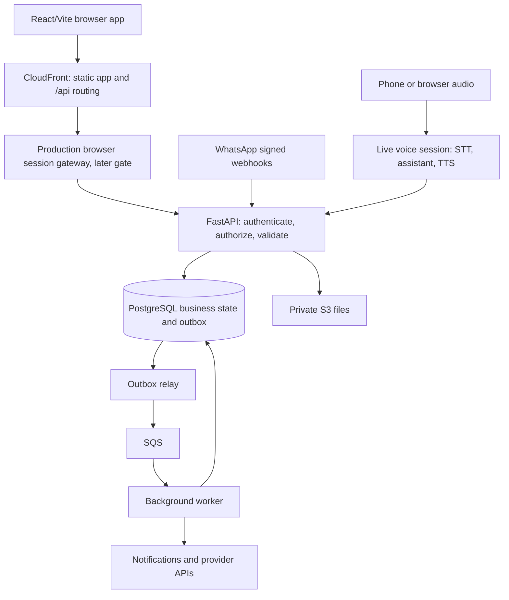

# Bolmava production architecture proposal

Owner: Rohan-Ktksu. Updated: 31 October 2026 (Asia/Kolkata).

Status: researched proposal for version 2. Nothing here is deployed, and it authorizes no purchase.

The frontend uses React with Vite, and the database is PostgreSQL in development, CI and production. The original brief is kept in [docs/PROJECT_HANDOFF.md](docs/PROJECT_HANDOFF.md). The local fictional-data demo must keep running without paid APIs.

## Recommended stack

| Layer | Proposed choice | Purpose |
| --- | --- | --- |
| Web | React, Vite, TypeScript | Client-side buyer, seller, support and finance interfaces with accessible Telugu/English navigation and a shared API client. |
| Backend | Python FastAPI, Pydantic, SQLAlchemy 2, Alembic | One modular backend with validated APIs, shared business rules, schema migrations, and OpenAPI contracts for the frontend. |
| Database | PostgreSQL; AWS RDS PostgreSQL in Mumbai for production | Authoritative organizations, inventory, quotes, orders, conversations, permissions, and financial events. |
| Hosting | Static Vite build on private S3 through CloudFront; API and workers on AWS ECS Fargate behind an Application Load Balancer | Serve the browser app and API on one site, with `/api` routed to FastAPI; support persistent voice connections and independent worker capacity. |
| Jobs | Amazon SQS and a Python worker using the backend's business modules | Retriable notifications, voice-note processing, reports, and reconciliation. |
| Authentication | Amazon Cognito user pools; PostgreSQL memberships and permissions | Managed sign-in, with organization authorization enforced by the backend. Require MFA for privileged staff. |
| Files | Private Amazon S3 storage | Product media, evidence, generated documents, and consented recordings. PostgreSQL stores ownership and metadata. |
| Application AI | A hosted LLM API with tool use as the first candidate (vendor chosen after evaluation) | Interpret requests and propose structured actions. Choose the actual model after language, latency, and cost evaluation. |
| Speech | Sarvam STT/TTS as the first candidate | Evaluate Indian-language speech on actual users and devices before committing. |
| Phone / WhatsApp | Exotel AgentStream candidate; Meta WhatsApp Cloud API | Phone audio streaming and authenticated messaging linked to the same account and trade state. |
| Payments | Provider-hosted Razorpay checkout candidate; Route only if eligible and needed | Introduce real collection/settlement through an approved provider after the separate live-money gate. |
| Operations | GitHub Actions, ECR, AWS Secrets Manager, CloudWatch, OpenTelemetry | Versioned releases, temporary deployment credentials, secrets, logs, traces, metrics, and alerts. |

These choices suit the owner's React/Vite preference, Python backend, Indian-language channels and transactional commerce. AWS reduces the number of infrastructure vendors but requires deployment and operating work. Vite produces static assets; its starter does not supply routing, data fetching or server rendering, so F00 defines those choices. Client-only public catalog pages may need a separate prerendered/public-page strategy if search-engine discovery becomes important. [React's Vite setup and tradeoffs](https://react.dev/learn/build-a-react-app-from-scratch), [Vite production build](https://vite.dev/guide/build), [Fargate architecture](https://docs.aws.amazon.com/AmazonECS/latest/developerguide/AWS_Fargate.html).

Pin supported stable framework, Python, Node, and database versions during implementation. Select a PostgreSQL major available on RDS in the chosen region and use that major locally and in CI. Do not select prereleases or leave dependency versions floating.

## Request and data flow

Web, WhatsApp, and voice call the same authorized business operations. The React app must not become a second implementation of order or payment rules. Generated frontend types can follow FastAPI's OpenAPI contract. In local development, Vite proxies `/api` to FastAPI. Production browser authentication needs a same-origin gateway/session design before real users; Vite does not provide that server component.

Keep one backend codebase organized by identity, catalog, trade, conversations, support, and finance. Deploy API and workers as separate processes. Add modules as milestones require them; no initial business microservice split, Kubernetes, Kafka, or separate vector database is needed. Start catalog matching with explicit filters and PostgreSQL search. Introduce Redis only for a demonstrated cache, cross-instance messaging, or rate-limit requirement; it cannot become authoritative stock or payment storage.

## Transactions and reliable jobs

Orders, quote acceptance, inventory reservation, and related audit events commit in database transactions. Use conditional updates or row locks plus constraints to prevent overselling. A repeated confirmation with the same organization-scoped idempotency key must return the original result. Reject an expired or superseded quote and bind confirmation to the actor and exact terms version. Store INR in integer paise using appropriately bounded integer columns; never floating-point money. [PostgreSQL locking](https://www.postgresql.org/docs/current/explicit-locking.html).

Save an outgoing event in a PostgreSQL outbox in the same transaction as the business change. A relay publishes it to SQS and may publish duplicates after a failure. Workers deduplicate durable event IDs, use provider idempotency where available, and reconcile uncertain provider outcomes. Configure retries, visibility timeouts, dead-letter handling, and operational alerts. SQS standard queues can redeliver messages; delivery does not guarantee that an external effect happens exactly once. [SQS delivery behavior](https://docs.aws.amazon.com/AWSSimpleQueueService/latest/SQSDeveloperGuide/standard-queues-at-least-once-delivery.html).

FastAPI in-process background tasks are unsuitable for jobs that must survive an application restart. Use the worker for those tasks. Live audio stays on an authenticated WebSocket path; it must not wait behind report generation or queued notifications. Persist resumable conversation and pending-action state in PostgreSQL. Process memory can hold transient audio, but cannot be the only location for shared business state. [FastAPI background tasks](https://fastapi.tiangolo.com/tutorial/background-tasks/), [WebSocket example limitations](https://fastapi.tiangolo.com/advanced/websockets/).

## Production infrastructure and recovery

Proposed primary region: Mumbai, `ap-south-1`. Put RDS in private subnets with access restricted to application roles/network paths. Use TLS, least-privilege database users, bounded connection pools, and separate staging/production resources. Use ECS task roles for AWS access and Secrets Manager for service credentials.

For the live trading service, plan RDS Multi-AZ, automated backups, point-in-time recovery, and demonstrated restore procedures. The Multi-AZ standby provides failover; it does not serve read traffic. A cheaper single-AZ staging or limited pilot is a conscious availability tradeoff. Define recovery time and acceptable data loss targets with the owner before sizing. [RDS PostgreSQL](https://docs.aws.amazon.com/AmazonRDS/latest/UserGuide/CHAP_PostgreSQL.html), [Multi-AZ standby behavior](https://docs.aws.amazon.com/AmazonRDS/latest/UserGuide/Concepts.MultiAZSingleStandby.html).

Run production API/worker capacity across availability zones, sized after load and concurrent-call tests. Serve the static web bundle through CloudFront, with app-route fallback for deep links while missing assets and `/api` retain correct errors. Apply appropriate WAF/rate controls. Never cache private organization responses as public content. Configure load-balancer WebSocket timeouts, keepalives, connection draining, and call interruption recovery. Do not promise deployments will preserve every active call.

Keep S3 buckets private. After checking organization access, issue short-lived presigned links for a specific object/action. Treat these URLs as bearer credentials, not single-use links. Use unique upload keys, size/type restrictions, malware checks for untrusted attachments, and retention/deletion rules. [S3 presigned URLs](https://docs.aws.amazon.com/AmazonS3/latest/userguide/using-presigned-url.html).

## Identity, AI, channels, and money

Cognito authenticates the person; PostgreSQL membership and permission checks decide what that person can do in an organization. Validate token signature, issuer, expiry, intended client/audience, and token usage as appropriate. Choose secure browser session handling and CSRF protection in SPEC.md. A phone number, voice, or WhatsApp display name alone cannot authorize a trade. Use explicit, expiring account-linking proofs. A local fictional-user authentication mode must be explicitly non-production and fail closed in production configuration. [Cognito user pools](https://docs.aws.amazon.com/cognito/latest/developerguide/cognito-user-pools.html).

The application uses provider APIs, separately billed from any development-tool subscription. Preserve deterministic operation without API keys for the local demo. The assistant proposes schema-validated tool calls; backend checks enforce authorization, totals, stock, state, and confirmation every time. AI has no unrestricted SQL access and cannot independently approve or release funds.

Evaluate Sarvam with Telugu/English code-switching, product names, quantities, prices, noise, and telephone audio. STT and TTS language coverage differ. Read back critical values, allow correction, measure latency, and test human escalation. Exotel is a telephony candidate; use and verify a flow supporting real human transfer. Its direct Connect Voice AI path explicitly lacks agent transfer, while its Flow documentation describes a bot-to-human connection. Neither is an implemented integration here. [Sarvam language guidance](https://docs.sarvam.ai/api/getting-started/building-for-india), [Exotel direct connection](https://developer.exotel.com/docs/agentstream/connect-voice-ai), [Exotel Flow](https://developer.exotel.com/docs/agentstream/connect-voice-ai-flow).

For WhatsApp, verify webhook signatures, deduplicate provider message IDs, and save delivery outcomes without treating delivery as purchase consent. Confirm current business access, template rules, prices, and media restrictions before implementation. Meta's overview returned HTTP 429 during this review, so those current account requirements remain unverified. [Meta Cloud API overview](https://developers.facebook.com/docs/whatsapp/cloud-api/overview/).

Keep payments simulated through the demo. Before accepting real funds, settle the business collection/settlement model, provider eligibility, merchant onboarding, reconciliation, refund/dispute procedures, and distinct human approval rules. Razorpay Route documents marketplace splitting and eligibility requirements; availability to this new project is not established. Do not market provider settlement as platform-operated escrow. [Razorpay Route](https://razorpay.com/docs/payments/route/).

AWS Mumbai does not guarantee that external speech, AI, messaging, or telephony vendors process all data in India. Record actual data flows, provider terms, consent, and retention before a real-user pilot. Hosting choices alone do not establish legal compliance.

## Development and release sequence

1. Write the API contract (SPEC.md) first, then implement the backend with SQLAlchemy/Alembic, fictional seeds and documented Windows setup. Docker Compose supplies local PostgreSQL; do not substitute SQLite in integration tests.
2. Build the React/Vite frontend against that API one bounded slice at a time, with independent review of organization isolation, concurrency, quote confirmation, accessibility and the complete browser journey. Introduce durable jobs and channel adapters when their milestone requires them.
3. Build CI with real PostgreSQL integration tests, migration checks, backend tests, and browser journey tests. Publish container images to ECR. Configure GitHub Actions with AWS OIDC scoped to the owner's repository and release environment instead of stored long-lived AWS keys. [GitHub AWS OIDC](https://docs.github.com/en/actions/how-tos/secure-your-work/security-harden-deployments/oidc-in-aws).
4. Before provisioning, document expected users, peak requests, concurrent calls, storage, retention, availability targets, provider access, and a priced monthly estimate. Obtain authorization for the actual resources and spend. All accounts, billing, domains, and secrets remain controlled by Rohan-Ktksu.
5. Stage and verify backup restore, compatible schema migrations, application rollback, webhook replay, worker crash/retry, concurrent stock purchases, privileged MFA, and voice handoff. Run migrations through one controlled release job, not every web replica. Separate app rollback from potentially destructive data rollback.
6. Before live launch, meet security, support, language, privacy, and provider gates. Monitor errors, latency, queue age, dead letters, failed payments, and call failures using redacted logs and traces. Define incident ownership and spending alerts.

Local development can retain the original zero incremental API/hosting spend target on existing hardware. Production AWS capacity, AI, speech, phone calls, WhatsApp, authentication messages, storage, backups, and support have separate costs. No monthly figure is promised without the workload estimate. This document authorizes no purchase, production deployment, or live payment activation.
