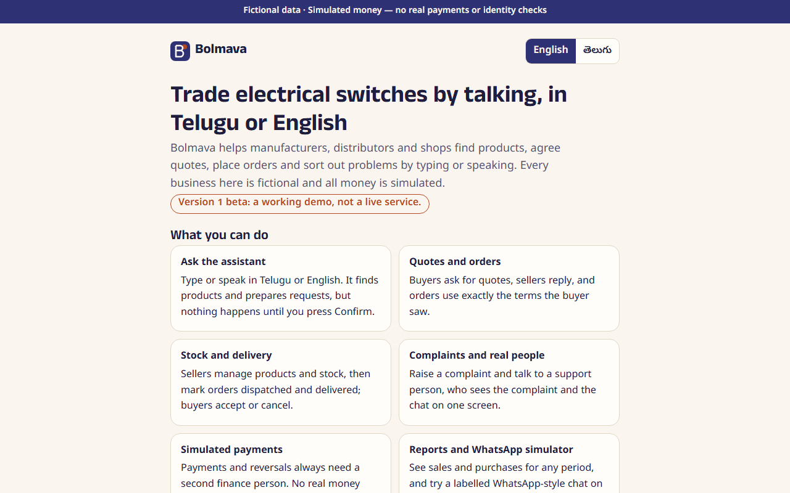

# Bolmava: talk-to-trade for electrical switches

**Version 1.0.0 beta** · a working demo, not a live service · fictional data · simulated money

Bolmava helps manufacturers, distributors and shops of electrical switches find products, agree quotes, place orders and sort out problems by **typing or speaking, in Telugu or English**. The rules live in the server and database, not in the chat: the assistant only proposes, a person always presses **Confirm**, and anything to do with money needs **two people**.

**Showcase site:** https://rohan-ktksu.github.io/bolmava-public/ (screens, demo flow and journey)



## Try the demo flow

Run it locally (below), open http://localhost:5173 and pick a fictional person on the front page. No password is needed in this demo.

| Who to pick | What to try |
| --- | --- |
| **Anitha**, seller (catalog manager) | Add a product and stock under *Products & stock*; answer a request under *Enquiries & quotes* with a quote |
| **Lakshmi**, distributor owner | In *Conversation* say or type "find 6 amp switch", then "quote", "1", "100", "Guntur" and press **Confirm**; review a quote and confirm the order; report an advance payment; open a complaint |
| **Suresh**, purchaser | The same in Telugu: "ఆరు ఆంపియర్ స్విచ్ కావాలి", "కొటేషన్", "ఒకటి", "వంద", "గుంటూరు" |
| **Farah** or **Arjun**, finance | Approve the exact terms of a payment, record it, ask for a reversal; the other person must approve it |
| **Sanjay** or **Vani**, support | Take a complaint, write internal notes, chat with the customer on the complaint page, resolve it |
| **Kiran**, shop owner | *Register a business*, typing or speaking each detail |

The full 14-step story:

| # | Step | v1 beta |
| --- | --- | --- |
| 1 | A manufacturer registers (by voice) | ✅ Register a business, typed or spoken (demo people; real accounts come later) |
| 2 | The manufacturer lists a product | ✅ |
| 3–4 | A distributor asks; the assistant finds the manufacturer | ✅ |
| 5–6 | A quotation, then a negotiated second version | ✅ |
| 7 | The buyer confirms a simulated order on the exact terms | ✅ |
| 8 | Finance reviews a simulated advance (second person) | ✅ |
| 9 | Delivery | ✅ |
| 10–12 | Quality complaint, handover to a person, support updates it | ✅ |
| 13 | The seller asks the assistant for a report | ✅ |
| 14 | The seller continues on WhatsApp or the portal | Portal ✅ · WhatsApp: labelled simulator only |

Steps 2–13 run automatically in a browser test (`frontend/e2e/journey.spec.ts`) on every change.

## Features

- **Assistant** in Telugu and English, by text or voice (the browser's free speech recognition), which proposes quote requests and orders but never acts without Confirm.
- **Quotes and orders**: versioned quotes; orders bound to the exact version and total; retries never order twice.
- **Products, stock and delivery**: seller catalog, stock changes with history, dispatch, delivery, acceptance, and cancellation that restores stock exactly once.
- **Complaints and human support**: complaints with messages and file details; the assistant hands over to a support person, who sees the complaint and the customer's chat on one screen. Internal notes never reach buyers or sellers.
- **Simulated payments**: advances, receipts and reversals with a second-person approval; balances computed only from recorded events.
- **Reports** for any period, sales separate from purchases.
- **WhatsApp simulator**: a clearly labelled chat on the same records. Nothing is sent to WhatsApp.

## Built with

| Part | Technology |
| --- | --- |
| Backend | Python 3.13, FastAPI, Pydantic, SQLAlchemy 2, Alembic, PostgreSQL 16 |
| Frontend | React 19, Vite, TypeScript, React Router |
| Live updates | PostgreSQL LISTEN/NOTIFY and a server-sent event stream |
| Voice | Web Speech API in Chrome and Edge (free, no account) |
| Tests | pytest on real PostgreSQL (124 tests + 10 review regressions), Node and Vitest unit tests (27), Playwright browser tests (57) |
| Automation | GitHub Actions; an advisory, AI-assisted Telugu wording check with free Gemini models |

The assistant is rule-based: it needs no AI service or API key.

## Run it locally

Requirements: Python 3.13, PostgreSQL 16, Node 24. Everything is free and local.

1. Create the database role and databases (PostgreSQL superuser):

   ```sql
   CREATE ROLE bolmava LOGIN PASSWORD 'bolmava';
   CREATE DATABASE bolmava OWNER bolmava;
   CREATE ROLE bolmava_test LOGIN PASSWORD 'bolmava_test';
   CREATE DATABASE bolmava_test OWNER bolmava_test;
   ```

   Or use Docker: `docker compose up -d` in `backend/`.

2. Backend (PowerShell):

   ```powershell
   cd backend
   py -3.13 -m venv .venv
   .\.venv\Scripts\Activate.ps1
   pip install -r requirements.txt -r requirements-dev.txt
   Copy-Item .env.example .env      # then set LOCAL_AUTH_SECRET to a long random string
   alembic upgrade head
   python -m app.seed
   uvicorn app.main:app --port 8000
   ```

3. Frontend (another terminal):

   ```powershell
   cd frontend
   npm ci
   npm run dev                      # http://localhost:5173
   ```

More detail, including Linux/macOS commands, backup and restore, and the API walkthrough, is in [backend/README.md](backend/README.md) and [frontend/README.md](frontend/README.md).

### Run the tests

```powershell
cd backend
$env:BOLMAVA_DESTRUCTIVE_TESTS = "1"     # the tests erase and rebuild bolmava_test
python -m pytest
cd ..\frontend
npm run lint; npm run build; npm test
npx playwright test                      # needs a bolmava_e2e database; see frontend/README.md
```

## Project layout

```text
backend/    FastAPI app, models, Alembic migrations, seed data, tests
frontend/   React + Vite app, unit tests, Playwright browser tests
site/       Static showcase site (GitHub Pages)
docs/       Design notes, Telugu review workflow and review sheet
tools/      Telugu review helpers
SPEC.md     The API contract and business rules
```

## How it was built

| When (2026) | Milestone |
| --- | --- |
| 26 Oct | The idea and ground rules: fictional data and simulated money from day one |
| 27 Oct | Specification first; backend foundation; quote requests, versioned quotes, orders and the assistant |
| 28–30 Oct | Simulated payments with maker-checker approval, delivery, complaints with human handoff, reports; independent review findings fixed with regression tests |
| 31 Oct | React/Vite frontend foundation, CI on real PostgreSQL, first trade screens |
| 1 Nov | Products and stock, delivery screens, AI-assisted Telugu review |
| 7 Nov | Conversation with live replies and notifications |
| 21 Nov | Reports, support workspace, simulated finance |
| 22 Nov | Complaints, clean-install and full-demo checks, voice input tuned with real microphone tests, WhatsApp simulator, business registration, complaint and chat on one screen, front page: **v1.0.0 beta** |

## Limits of v1 beta

- Not a live service: fictional people and businesses, simulated money, and a demo sign-in without passwords.
- Voice needs Chrome or Edge, a `localhost` or `https` address and internet; check the words before sending.
- Telugu is AI-assisted; a fluent human review is next.
- **Version 2** plans: secure sign-in with real accounts, an online staging server, stored evidence files, production voice and phone, real WhatsApp, and real payments only after a separate decision.

---

Bolmava v1.0.0 beta by [Rohan-Ktksu](https://github.com/Rohan-Ktksu). All businesses, people and money in this project are fictional or simulated.
